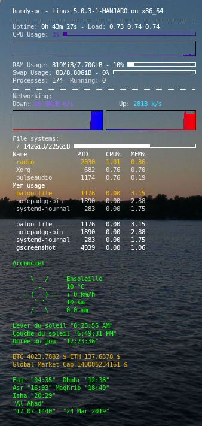

# Conky Weather / Meteo

Developer: Hamdy Abou El Anein
Contact: hamdy.aea@protonmail.com
License: GNU GPL v3 (see LICENSE).

A classic Conky dashboard configuration for Linux with weather, sunrise,
sunset, prayer times, network speed and system monitoring.



## Modernized scripts

The historical Bash helpers downloaded and executed a remote Python script
for each speed test, made multiple redundant HTTP requests and hard-coded
manual UTC offsets. The modernized versions:

- `speedtest2.bash` uses the **installed** `speedtest-cli` and parses its
  JSON output, with a 50-second timeout. It **never executes downloaded code**.
- `islamictime2.sh` makes one HTTPS request to AlAdhan, validates the JSON
  response and allows location overrides via `PRAYER_CITY`,
  `PRAYER_COUNTRY`, `PRAYER_TIMEZONE`.
- `sunsetsunrise2.sh` makes one HTTPS request to sunrise-sunset.org, then
  converts the UTC response to local time with GNU `date` (handles DST).
  Configure `SUN_LAT` and `SUN_LON` in your environment.
- The original script names without `2` are maintained as compatibility
  wrappers for existing Conky configurations.

Install dependencies with your package manager: `curl`, `jq`, `python3`,
`speedtest-cli`, `coreutils` and Conky. The `.conkyrc` file is a **sample**:
adapt interface names, locations, and absolute paths before copying it into
your home directory. This repository does not modify your running Conky.

## Examples

```sh
PRAYER_CITY=Fribourg PRAYER_COUNTRY=CH ./islamictime2.sh
SUN_LAT=46.8 SUN_LON=7.15 ./sunsetsunrise2.sh
./speedtest2.bash
```

The speed test consumes bandwidth. Use a long Conky update interval
(at least 3600 seconds), not a short CPU-monitor refresh.

## Offline regression tests

```sh
python3 -m unittest discover -s tests -v
```

The tests mock all HTTP and speedtest commands and never contact external
services. Five tests cover JSON parsing, time-zone conversion and errors.

Historical scripts are preserved in the `old` branch.
